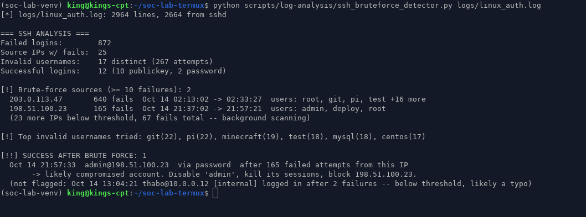
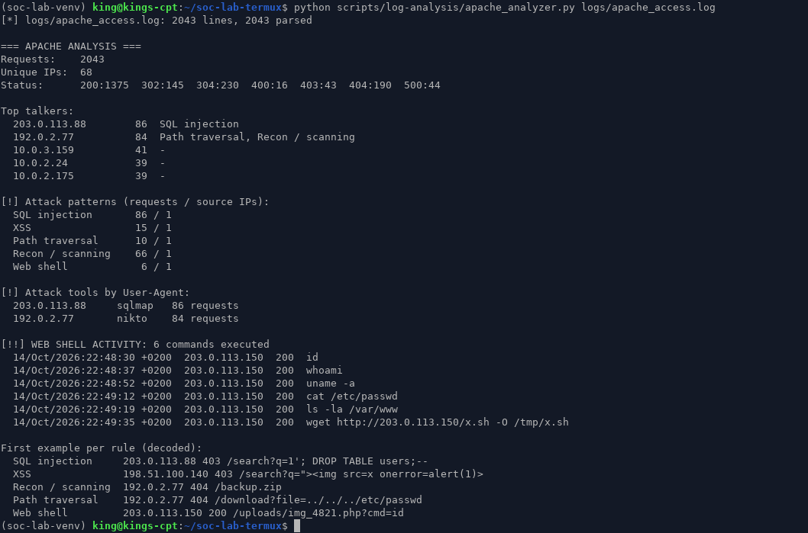
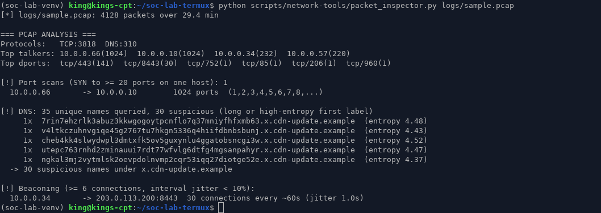

[](https://github.com)
[](https://www.python.org/downloads/)
[](LICENSE)

# SOC Lab Termux
Android-based defensive security lab for SOC analyst practice. No cloud, no VPN, no root required.

## What This Is

A working cybersecurity home lab built for Android/Termux. It generates realistic synthetic attack logs, inspects network packets, and produces triage-ready reports — the same core tasks a SOC Tier 1 analyst performs daily.

**Built by:** Kgosi Ntshingila
**Purpose:** Demonstrate hands-on SOC skills without a university degree or expensive training labs.

## Why This Exists

Most people trying to break into cybersecurity can talk about logs, but they've never actually parsed thousands of lines, identified attack patterns, and written findings from them. This repo is the proof.

## What's Inside

- `scripts/log-analysis/ssh_bruteforce_detector.py` — brute-force sources, dictionary attacks, and **successful logins that follow a brute-force run** (likely compromise)
- `scripts/log-analysis/apache_analyzer.py` — SQLi, XSS, path traversal, recon scanning, web-shell commands, and attack tools by User-Agent (URL-decodes payloads first)
- `scripts/network-tools/packet_inspector.py` — pcap triage with scapy: port scans, DNS tunneling, C2 beaconing
- `scripts/tools/generate_sample_logs.py` — synthetic `auth.log` + Apache access log in the real formats
- `scripts/tools/generate_sample_pcap.py` — synthetic pcap with a scan, a beacon and DNS tunneling
- `install.sh` — setup for Termux (also runs on Debian/Ubuntu)

## Output

Real runs against the sample data (`--seed 1014`), screenshotted from a terminal.

**SSH brute force.** Two brute-force sources. One of them (`198.51.100.23`) gets into `admin` after 165 failures, and that's the only alert. An employee who mistyped his password twice is deliberately *not* flagged.



**Apache access log.** A sqlmap run, a Nikto scan, manual XSS probing, and a web shell at `/uploads/img_4821.php` used to run `id`, `cat /etc/passwd` and pull a second-stage script.



**PCAP.** An internal SYN scan of 1,024 ports, DNS tunneling through base32 subdomains, and a beacon to `203.0.113.200:8443` every ~60s.



### Tested on real data too

The sample data is synthetic, so I also ran the SSH detector on a real server log: [loghub OpenSSH_2k](https://github.com/logpai/loghub/tree/master/OpenSSH), 2,000 lines of real `sshd` traffic. It found 519 failed logins from 23 IPs. Six IPs crossed the brute-force threshold, the loudest being `183.62.140.253` with 286 failures in 10 minutes. There were 0 successful logins after brute force.

## About the sample data

`generate_sample_logs.py` aims to look like a real server, not a demo:

- `auth.log` is real syslog format (`Oct 14 21:37:02 web01 sshd[4242]: ...`), including the `Invalid user` / `pam_unix` / `[preauth]` lines that sshd actually writes.
- Most lines are normal activity: cron, admins logging in with SSH keys. Brute force is hundreds of failures with almost no successes, which is what you see on the real internet.
- Apache lines use Combined Log Format with timezone, referer and user-agent. Attack payloads are URL-encoded the way Apache logs them, so the analyzer has to decode them.
- Every attacker IP is from the RFC 5737 documentation ranges (`192.0.2.0/24`, `198.51.100.0/24`, `203.0.113.0/24`), so none of them point at a real host.

Pass `--seed N` to get the same dataset every time. Leave it out to get a new one.

## Setup

```bash
git clone https://github.com/kingswr1d/soc-lab-termux.git
cd soc-lab-termux
bash install.sh          # installs scapy, generates logs/ and logs/sample.pcap

python3 scripts/log-analysis/ssh_bruteforce_detector.py logs/linux_auth.log
python3 scripts/log-analysis/apache_analyzer.py logs/apache_access.log
python3 scripts/network-tools/packet_inspector.py logs/sample.pcap
```

The two log analyzers only use the standard library (Python 3.8+). `packet_inspector.py` needs `scapy`.
All three work on real logs too, e.g. `sudo python3 scripts/log-analysis/ssh_bruteforce_detector.py /var/log/auth.log`.

Exit codes are usable in scripts: `0` = nothing found, `1` = suspicious activity, `2` = likely compromise (success after brute force, or web-shell commands).

## How the detections work

### ssh_bruteforce_detector.py

- Parses `Failed password` / `Failed password for invalid user` / `Accepted password|publickey` lines from sshd.
- Counts failures per source IP. An IP with `>= --threshold` failures (default 10) counts as a brute-force source.
- **Success after brute force:** an `Accepted` login from an IP that had `>= threshold` failures since its last successful login. A couple of typos before a good login stays below the threshold and is listed as "not flagged", so you can see the reasoning.
- Lists the most-tried invalid usernames (`pi`, `git`, `test`, ...), which point to a dictionary attack.

### apache_analyzer.py

- Parses Common or Combined Log Format and URL-decodes paths twice, so `%2527` and `%27` are both caught.
- Regex rules for SQLi (`UNION SELECT`, `' OR '1'='1`, `SLEEP(`, `information_schema`), XSS, `../` traversal, recon paths (`.env`, `.git/`, `wp-login.php`, backups) and web-shell parameters (`.php?cmd=`).
- Flags known attack tools by User-Agent (sqlmap, Nikto, nmap, gobuster, ...).
- Prints every web-shell command it sees, with timestamp and status code.

### packet_inspector.py

- **Port scan:** one source sending SYNs to `>= 20` different ports on one host.
- **DNS tunneling / DGA:** query names whose first label is longer than 25 characters or has Shannon entropy above 3.8, grouped by parent domain.
- **Beaconing:** the same src → dst:port opened at least 6 times, with interval jitter under 10% of the mean.

## Project Status

- [x] Lab environment documented
- [x] Log analyzer scripts
- [x] Brute-force detector
- [x] Synthetic data generator
- [x] Network packet inspector
- [x] Packaged for Termux on Android
- [ ] PortSwigger lab writeups added
- [ ] TryHackMe SOC Level 1 completion certificate
- [ ] CompTIA Security+ exam scheduled (5 November 2026)
- [ ] ISC2 CC exam (was scheduled for 31 July 2026)
- [ ] AWS cloud practitioner exam scheduled

## Skills Demonstrated

- Python script development
- Regular expression pattern matching
- Log source analysis (Apache, Linux auth)
- Network packet inspection
- Defensive detection engineering
- Technical documentation
- Privacy/compliance framing (POPIA-ready SA context)

## Roadmap for This Repo

1. Add TryHackMe and PortSwigger lab writeups
2. Add custom YARA rules for log-based detection
3. Add a JSON alerting pipeline (script → jq filter → report)
4. Add a small REST API wrapper around analyzers so they can be called remotely

## License

MIT
